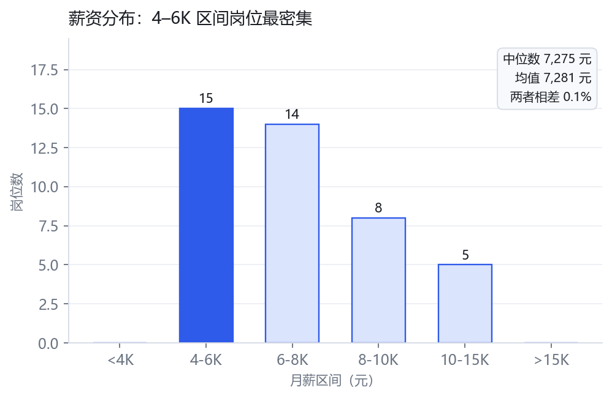
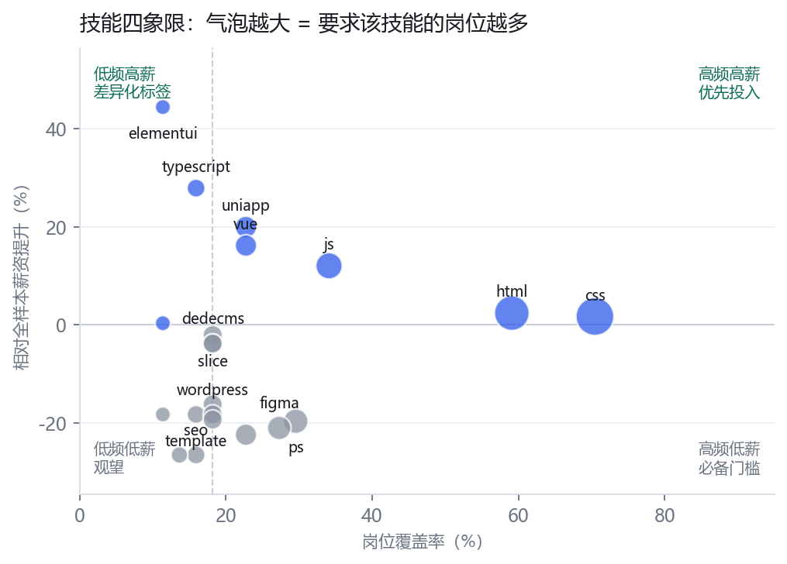
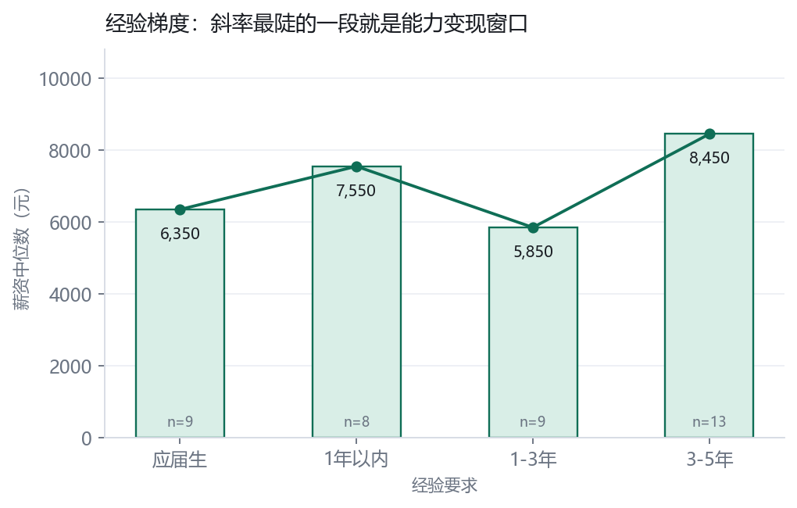
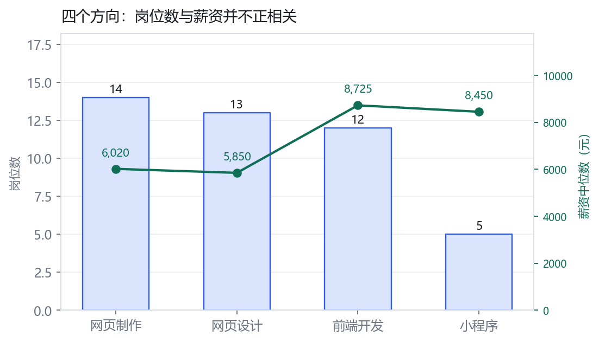
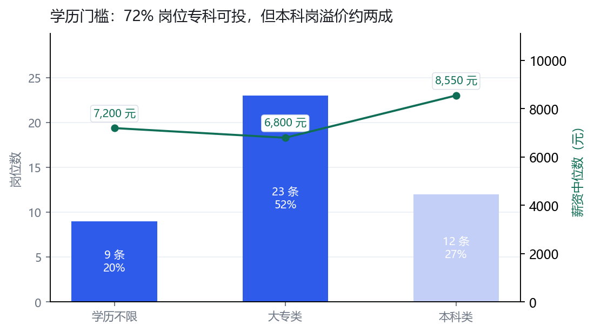

# 网页制作招聘岗位数据分析 · 完整项目报告

> 专科大数据技术专业项目作品 · 从数据采集到业务结论的完整实践
> Python（Requests / BeautifulSoup / Pandas / Matplotlib）

| 原始样本 | 清洗保留率 | 月薪中位数 | 专科可投占比 |
|:---:|:---:|:---:|:---:|
| 56 条 | 78.6% | ¥7,275 | 72.7% |

---

## 1. 项目概述

### 1.1 选题背景

「网页制作」是中小企业最常见的互联网基础岗位之一，岗位分散在建站服务商、电商自营、广告代运营等各类公司中，招聘信息口径不统一、薪资写法五花八门。对一名准备求职的大数据专业学生来说，与其凭感觉投简历，不如先用数据把三个问题弄清楚：**这个市场给多少钱、要什么技能、专科背景的机会在哪里**。这正是本项目的出发点——用一次完整的招聘数据分析，为自己的求职决策提供依据，同时向用人单位证明数据处理能力。

### 1.2 业务目标

1. **描绘市场结构**：薪资水位、岗位方向分布、企业类型构成；
2. **拆解能力要求**：高频技能与薪资溢价的关系，产出学习优先级清单；
3. **识别个人机会**：学历门槛、经验要求与可投岗位占比，明确投递策略；
4. **沉淀方法论**：形成「采集 → 清洗 → 分析 → 可视化」可复用的完整流程。

### 1.3 项目产出

- 可复现的数据处理管道（清洗 7 步，每步有日志可追溯）
- 44 条标准化岗位宽表（29 个字段）与 5 类分析结果表
- 5 张分析图表 + 交互式看板 + 本报告
- 4 条可直接指导求职行动的业务结论

---

## 2. 数据源与采集方案

### 2.1 数据源选型：按合规风险分层

招聘平台的用户协议与 robots 协议差异很大，采集前先按风险分层选源：

| 层级 | 数据源 | 风险 | 用途 |
|:---:|---|:---:|---|
| A | 天池 / Kaggle 等公开数据集、人社部 100 城供求报告 | 极低 | 方法验证、薪资合理性校验 |
| B | 中国公共招聘网、企业官网校招页、高校就业信息网 | 低 | **主样本来源**，字段干净 |
| C | 前程无忧、智联招聘等列表页 | 中 | 确认 robots 后小样本低频采集 |
| D | 需登录 / 明确禁止采集的平台 | 高 | 不采集 |

### 2.2 采集字段（采集层 20 个）

- **岗位侧**：岗位名称原文、JD 全文、技能标签、发布日期
- **企业侧**：公司名、规模、类型（建站服务商 / 电商自营 / 广告代运营等）、行业
- **要求侧**：薪资原文、学历要求、经验要求、城市、区域
- **溯源侧**：来源平台、原始 URL、采集时间、去重指纹

> **两条字段设计原则**：薪资只存原文（如「6.5-8.2K·13薪」），解析放到清洗层，因为解析规则一定会反复修改；空值统一存空字符串，避免「面议」「0」等占位值污染后续统计。

### 2.3 采集规范与合规边界

- 单线程采集，请求间隔 2–4 秒随机，单日单站请求量控制在千次以内
- 采集前检查 robots 协议，遵守目标站点的抓取限制
- **不采集** HR 姓名与联系方式（个人信息，无合法性基础）、不绕过验证码与登录态、不对外发布原始数据集
- 原始 HTML 落盘留档，被 403/429 拒绝时退避重试而非对抗封禁

### 2.4 薪资原文的复杂度

| 薪资形态 | 条数 | 占比 | 处理难点 |
|---|:---:|:---:|---|
| 月薪 | 36 | 81.8% | 区间与「·13薪」后缀混杂 |
| 底薪+提成 | 3 | 6.8% | 实际上限不可知 |
| 年薪 | 2 | 4.5% | 需按 12 个月折算 |
| 面议 | 2 | 4.5% | 标记后不参与薪资统计 |
| 日薪 | 1 | 2.3% | 按 21.75 个工作日折算 |

六种写法并存——这正是把解析独立成一步、且统一用区间中位数做统计的原因。

---

## 3. 数据预处理与清洗

原始数据 56 条，清洗后有效样本 **44 条，保留率 78.6%**。清洗分 7 步执行，每一步的剔除数量都记录在日志中，全程可追溯：

| 步骤 | 清洗前 | 清洗后 | 剔除 | 保留率 | 说明 |
|---|:---:|:---:|:---:|:---:|---|
| 1. 文本标准化 | 56 | 56 | 0 | 100.0% | 去空格/全角括号、城市去行政后缀 |
| 2. 剔除无关岗位 | 56 | 51 | 5 | 91.1% | 培训广告 3 条、游戏岗 2 条 |
| 3. 去重 | 51 | 46 | 5 | 90.2% | 完全重复 3 条、伪新岗位 2 条 |
| 4. 薪资解析与异常值 | 46 | 44 | 2 | 95.7% | 解析成功 95.5%，剔除硬边界 2 条 |
| 5. 学历经验映射 | 44 | 44 | 0 | 100.0% | 学历未匹配 0 条、经验未匹配 0 条 |
| 6. 缺失值处理 | 44 | 44 | 0 | 100.0% | 缺失用"未标注"占位，技能用 JD 回填，不删行 |
| 7. 类型转换 | 44 | 44 | 0 | 100.0% | 日期/薪资/人数转数值，生成岗位方向与技能数 |

### 3.1 三个关键处理决策

**① 双指纹去重。** 只按 URL 去重会漏掉大量「HR 改个标题重发」的岗位，因此设计两级指纹：一级为「公司+岗位+薪资+城市」抓原样重发；二级为同公司内 JD 前 120 字摘要，抓改头不换面的伪新岗位。二级指纹限定同公司比较，避免误杀同一服务商的真实不同岗位。

**② 缺失值占位而不删行。** 学历、经验未标注统一记为「未标注」；技能标签缺失时用 JD 全文按技能词典（63 项技能 / 134 条别名）回填。不删行的原因：不写学历要求的往往正是中小企业——这个岗位的主要雇主，删行会造成系统性偏差。

**③ 异常值按业务规则处理。** 薪资低于 1K 或高于 60K 的硬边界直接剔除；IQR 法只报告不删除——小样本下 IQR 会把真实的高薪前端岗误判为异常值。

### 3.2 薪资解析状态机

统一折算为月薪：「6.5-8.2K·13薪」先摘除「·13薪」再解析数值，否则 13 会被当成薪资数字；「280元/天」按 21.75 天折算；「7000+提成」上限不可知则保留底薪；「面议」标记后不参与薪资统计。解析成功率 **95.5%**。

> **调试记录**：清洗过程中发现并修复了「异常值行被去重规则提前删除」的顺序问题——去重与异常检测的执行顺序会互相影响，最终确定先剔除无关岗位、再去重、最后做薪资异常检测。

---

## 4. 探索性数据分析

### 4.1 薪资分布：报价集中在 4–6K，中位数被中端岗位撑住

众数区间 **4–6K**，占 35.7%；全样本月薪中位数 **¥7,275**，均值 ¥7,281，P25–P75 为 ¥5,700–¥8,388，偏度为正（右偏）——少数高薪前端岗把均值抬了上去。**分析上的含义**：描述这个岗位的薪资必须用中位数和分位数，只报均值会系统性高估「典型岗位」的待遇。

### 4.2 技能需求：入场券与加价项是两类技能

覆盖率最高的 CSS（70.5%）与 HTML 几乎没有薪资溢价——它们是**入场券**：不学进不来，学了不加分。带来显著溢价的是覆盖率仅 11.4% 的**组件库（+44.3%）**，以及 JS、Vue 等框架类技能——属于「低频高薪」的差异化标签。PS / Figma 的提升度为负，说明设计技能在该岗位是基础项而非加分项。

### 4.3 经验梯度：能力变现窗口在 1–5 年

| 经验要求 | 岗位数 | 薪资中位数 |
|---|:---:|:---:|
| 应届生 | 9 | 6,350 元 |
| 1年以内 | 8 | 7,550 元 |
| 1-3年 | 9 | 5,850 元 |
| 3-5年 | 13 | 8,450 元 |
| 经验不限 | 5 | 5,650 元 |

从 1–3 年到 3–5 年，中位数跳升 **+44.4%**，是梯度中最陡的一段——入行后前 3 年补齐高溢价技能，正处于能力变现窗口。需要说明：1–3 年档的中位数出现回落，未通过单调性检验，小样本下梯度存在波动，这条结论应作方向性参考而非精确预测。

### 4.4 岗位方向：岗位最多的方向不是给钱最多的方向

「网页制作 / 网页设计」合计占样本约六成，薪资中位数只有 ¥6,020；「前端开发」方向中位数达 **¥8,725，高出 +44.9%**。控制学历（仅看专科可投子集）后差距仍保留 +31.2%，说明差异来自岗位本身的价值，而不是学历结构。**岗位多的地方竞争者也最多**——这条结论直接决定投递顺序。

### 4.5 学历门槛与技能组合

**72.7% 的岗位对专科开放**；「学历不限」档的中位数（¥7,000）甚至高于「大专类」档——该岗位明显是技能导向而非学历导向。与本科要求岗位的薪资差距为 +22.1%，用一份对口的作品集对冲，比补学历更现实。

出现频次最高的三个技能两两组合：

| 技能组合 | 岗位数 |
|---|:---:|
| CSS + HTML | 20 条 |
| CSS + JavaScript | 12 条 |
| HTML + JavaScript | 11 条 |

排第一的组合是 **CSS + HTML**（20 个岗位同时要求）——这就是岗位的「标准配置」，面试准备与简历技能栏都应以此为基础，再叠加 1–2 个高溢价技能形成差异化。

### 4.6 企业类型分布

| 企业类型 | 岗位数 | 薪资中位数 |
|---|:---:|:---:|
| 建站服务商 | 22 | 7,750 元 |
| 电商自营 | 10 | 5,800 元 |
| 广告/代运营 | 8 | 7,525 元 |
| 企业自有IT | 3 | 11,300 元 |
| 软件外包 | 1 | 9,000 元 |

岗位最多的是**建站服务商**（22 条），薪资中位数最高的是**企业自有IT**（11,300 元）、最低的是**电商自营**（5,800 元）。这决定了投递策略：岗位量大、门槛友好的类型适合广撒网积累面试经验，薪资高的类型值得针对性准备作品。

---

## 5. 业务结论与项目价值

### 5.1 四条面向应届生的落地结论

> **结论 1 · 谈薪锚定中位数，投递设下限。** 报价最密集在 4–6K（35.7%），低于 5K 的岗位仅占 9.5%，过滤掉几乎不损失机会。全样本中位数 ¥7,275、P75 达 ¥8,388——带着作品集谈 7–8K 有数据支撑；低于 6K 的 offer 先问清岗位内容再决定。

> **结论 2 · CSS / HTML 练到能干活就停，主力时间押给高溢价技能。** CSS 覆盖 70.5% 岗位却零溢价（入场券）；组件库覆盖率仅 11.4% 却带来 +44.3% 提升，JS、Vue 亦有两位数溢价。学习时间的回报率排序，应该按这张表来。

> **结论 3 · 同样的技能栈，优先投「前端开发」方向。** 网页制作类岗位多（约六成）但中位数只有 ¥6,020；前端方向 ¥8,725（+44.9%），控制学历后差距仍达 +31.2%。前端方向设为第一梯队，「网页制作」岗作保底，投递顺序按此分层。

> **结论 4 · 大胆投，但会筛。** 72.7% 的岗位专科可投，且「学历不限」档薪资并不低（¥7,000）。技能匹配的本科岗照投（溢价 +22.1% 值得尝试）；标题含「零基础 / 包就业 / 学徒」的培训广告（样本中已剔除 5 条）直接跳过。

### 5.2 项目价值

**对求职决策**：把「凭感觉投简历」变成「按数据分层投递」——薪资锚点、投递下限、赛道优先级、学习路线四个问题都有了量化答案。

**对能力证明**：本项目完整走通「需求定义 → 合规采集 → 七步清洗 → 探索分析 → 可视化 → 业务结论」的链条，每一步的中间产物（清洗日志、分析结果表、出图脚本）都可复现，体现了数据处理工程化的习惯。

---

## 6. 项目总结、局限性与后续优化方向

### 6.1 项目总结

本项目以「网页制作招聘岗位」为对象，完成了一次端到端的数据分析实践：从 56 条原始信息出发，经过 7 步清洗得到 44 条标准化样本（保留率 78.6%），围绕薪资、技能、学历、方向、企业类型 5 个维度完成探索分析，产出 4 条可执行的业务结论。过程中沉淀了双指纹去重、薪资解析状态机、「占位不删行」的缺失值策略等可复用方法。

### 6.2 局限性（诚实声明）

1. **样本量与代表性**：当前样本 44 条、集中于单一城市，只能反映局部市场，结论外推需谨慎；
2. **薪资口径精度**：以区间中位数近似，「底薪+提成」类岗位的实际上限不可知，统计会低估该类岗位；「面议」岗位不参与薪资统计；
3. **缺乏时间维度**：为截面数据，无法观察薪资与需求的季节波动与趋势；
4. **分类口径主观性**：岗位方向、企业类型由规则归并，规则虽已写明，但换一套口径结论可能变化；
5. **相关不等于因果**：技能溢价是分组对比结果，未控制学历、经验、城市等混杂变量，PS 提升度为负本质是「设计方向薪资低」，不是「学 PS 会降薪」；
6. **文本抽取误差**：技能词典匹配存在已知歧义（如「PS」可指备注用语），需人工抽查误判率。

### 6.3 后续优化方向

1. **扩样本、扩城市**：接入多城市采集，做区域 × 薪资的交叉分析（岗位密度 × 薪资 / 生活成本的性价比指数）；
2. **引入回归模型**：控制学历、经验、城市后量化各技能的净溢价，替代当前的分组对比；
3. **增加时间序列**：按月采集同一批岗位，观察需求与薪资趋势；
4. **可视化升级**：将静态图表迁移为 ECharts 交互看板，支持筛选与下钻；
5. **自动化**：用定时任务串起「采集 → 清洗 → 看板更新」，形成持续运行的数据产品。

---

> **数据说明**：本报告为方法演示版本，当前数据为按真实字段结构构造的模拟样本（56 条，注入 7 类典型脏数据），用于验证全流程可复现性；替换为真实采集数据后，重跑三个脚本即可自动更新全部数字与图表。
